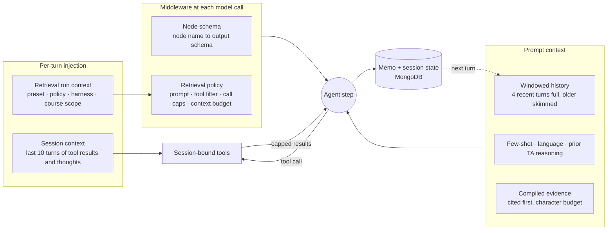

# SmartEdu
> A graph-based intelligent teaching assistant that guides and supervises mastery-oriented learning.

## Table of contents
1. [Introduction](#1-introduction)
2. [Features & engineering highlights](#2-features--engineering-highlights)
3. [How it works](#3-how-it-works)
4. [Inside SmartEdu](#4-inside-smartedu)
5. [Infrastructure & how to run](#5-infrastructure--how-to-run)

## 1. Introduction
**SmartEdu** is a proactive, mastery-oriented learning platform. Instead of delivering static content in a fixed order, it behaves like a human teaching assistant: it tracks what a student has actually learned and walks them through a structured Knowledge Graph one concept at a time, in an order the graph guarantees is sound.

Further reading:
1. [Full project report](docs/HK253-DATN-011.pdf)
2. Presentation slides (coming soon)
3. Live app (coming soon)

> [!NOTE]
> The current build targets the Computer Science curriculum and is at its demo phase.

## 2. Features & engineering highlights

### Features
- **Automated knowledge ingestion.** Drop in raw lecture slides, textbooks and lecture videos; the system reads, transcribes and analyzes them on its own.
- **Knowledge graph conversion.** Those sources become a structured Educational Knowledge Graph (EKG) that maps prerequisites and related concepts.
- **Mastery tracking.** The system scores proficiency per concept, spots gaps, and uses them to decide what comes next.
- **Grounded teaching assistant.** A multi-agent tutor answers questions from the verified graph and source material, recommends a personal learning path, and cites the exact page it drew from.

### Technical Highlights

**Durable, distributed ingestion that keeps the graph current without blocking the service.**
A course upload is submitted to an independently deployed Prefect control plane, and the endpoint returns a flow-run ID right away. A root flow dispatches each heavy stage (slide OCR, textbook OCR, LLM concept extraction, video speech-to-text) as a child deployment to a capability-routed worker pool, so OCR, LLM and ASR work can run on different machines. Stage results are cached against the source object's version and the stage's behaviour revision, so re-ingesting an unchanged file is a cache hit. Inside the LLM stage a bounded queue feeds a pool of extraction workers, and a node cache means only unseen concepts are touched. Every run writes an ingestion report (running, partial, failed, completed) that the admin UI tracks as a job card.

**Task-based harnessing: a small worker model under a large orchestrator.**
One SLM for every job causes context overhead and weak execution, while one model per role costs linearly in weights and cache. SmartEdu splits by role instead: a local 8B model is the RAG worker that loops over retrieval tools, and a large model orchestrates, routing the turn, judging roadmaps, teaching and writing the final reply. Agents are built once at startup; LangChain middleware then reshapes them at every LangGraph step, so the same agent acts as a retriever at one node and a roadmap explorer at the next with no extra model instance. The node name selects the output schema, a frozen retrieval policy selects the prompt and toolset, and each step sees only the context its task needs (see [Context injection](#context-injection)).

**Independent services behind shared contracts.**
The backend is split into four services (core, student, knowledge, TA), each a black box that talks to the others only through shared Pydantic contracts and receives its dependencies through an injection layer. Ingestion orchestration runs as its own Prefect service with its own workers and result storage. Any service can be deployed on its own by swapping its provider for an HTTP client, with zero change to the business logic inside.

**Stack:** FastAPI, Ollama, OpenRouter, Next.js, Docker, Prefect, Neo4j, Milvus, MongoDB, MinIO, MySQL. Orchestration uses LangGraph and LangChain; ingestion uses Docling, spaCy, SciBERT embeddings and faster-whisper.

## 3. How it works

A student signs in, then everything they do flows through the same backend.


**Sign in.** Credentials are checked against MySQL, and the server returns a short-lived access token, a refresh token (kept in an HTTP-only cookie by the Next.js proxy), and a random session ID. That session ID stands in for the student everywhere downstream, so the tutor and its tools never see the real student identity. The diagram below shows the two phases: starting a session registers a fresh UUID against the real student ID, and from then on every request carries only that UUID. The Student Tracker resolves it back to the real identity at the last moment, just before a database call. The dashed red line is that identity firewall. Past sessions can be listed and resumed, and the backend verifies ownership on every read and resume.


From the Next.js UI, these paths are all served by the FastAPI backend:

- **Chat.** A student's question goes to the agentic workflow, which reasons over Neo4j for knowledge and MongoDB for the student's state and history. The request is accepted immediately with a task ID; the UI polls or streams the answer and the agent's progress.
- **Read evidence.** Answers carry citations that open the source PDF at the cited page, beside the chat.
- **Search and roadmap.** A student searches concepts and textbook passages, or browses a course outline with prerequisite links and their own mastery (visualization inspired by KGGen).
- **Upload sources.** This one is admin-only: an administrator uploads slides, textbooks or lecture videos straight to MinIO through presigned URLs, starts ingestion, and follows its job card until the report completes.

## 4. Inside SmartEdu


### The knowledge graph
SmartEdu models a subject as a property graph it calls the Educational Knowledge Graph. Nodes are typed into a small ontology: communities (broad fields), topics (chapters or modules), concepts (the atomic ideas), and the rhetorical fragments that explain a concept. Edges carry meaning such as PART OF, RELATED TO, and PREREQUISITE OF. The prerequisite edges are forced to form a directed acyclic graph, so the system can sort them topologically into a learning order with no circular dependencies that would trap a student.

Building that graph from raw slides is the hard part. A single LLM pass tends to hallucinate, so extraction is split in two: a first pass pulls out the hierarchy (the skeleton), then a second pass only draws edges between an already-fixed set of concepts. Between the two passes, a deterministic NLP step cleans the candidate list. It normalizes and lemmatizes labels, checks each concept against DBpedia, merges near-duplicates by token overlap, and caches verified nodes so later ingestion stays incremental. Concepts DBpedia cannot confirm are not thrown away; they stay as low-weight leaf nodes, on the reasoning that a genuinely new idea can still be understood from its neighbors in the graph.

Textbooks and lecture videos play a different role: they never create concepts. A textbook is parsed into its authored section tree and split into semantic passages; a video is transcribed and cut into time-stamped segments. Concepts born from the slides are then anchored into these passages and segments by vector search, which is what lets the tutor cite a page as evidence.

### The teaching assistant
A chat turn runs through a hierarchical state machine. A router (no tools, temperature zero) reasons briefly over the student's state and recent history, ends on one intent word, and so classifies the question into one of five intents and hands it to the right sub-workflow:

- **Retrieve** answers factual questions through a versioned retrieval harness: by default an agentic tool loop over semantic concept search and textbook passage search, with an evidence-ledger harness and a deterministic fan-out harness kept for ablation.
- **Roadmap** plans what to learn next. It ranks concepts by how connected they are (out-degree centrality), finds the shortest prerequisite path to those anchors, and runs a critic-actor review before proposing a path. Because rewriting a whole trajectory is high-stakes, the roadmap waits for the student to confirm.
- **Teach** runs the lesson loop: retrieve evidence for the current concept, deliver content tuned to the student's Bloom's level, ask a question, judge the answer from the conversation alone, then either advance the student's position or hold the current concept for review. When retrieval finds no evidence, the lecture falls back to general knowledge and carries no citations.

Two lightweight intents round out the five: **confirm** applies a pending proposal the student agreed to, and **unknown** handles anything that does not fit the others.

Models are assigned by role. In the default configuration the RAG worker is qwen3:8b on local Ollama, and the orchestrating TA agent is gpt-oss 120B; the experimental evidence-ledger and planner harnesses swap in a long-context aggregator served through OpenRouter.

### Context injection
A small model fails first on context: too much history, too many tools, or the wrong scope. SmartEdu therefore never lets an agent assemble its own context. Everything reaches an agent step through four bounded channels.



- **Prompt context.** The last four turns stay in full and older turns shrink to their headings. The agent also sees a few-shot block, the language instruction, and the TA's two most recent replies. Retrieved evidence is compiled under a character budget: cited passages go first, and uncited ones are capped so distractors cannot poison the answer.
- **Middleware.** Before every model call, one middleware swaps the output schema according to the current node; another rewrites the system prompt and the tool roster from a frozen, hashed retrieval policy. It filters tools by ablation arm, caps calls per round and per run, rejects a repeated query, and stops searching before the context budget is exceeded. Call counts live in private state the model cannot see.
- **Run context.** Preset, policy, harness and course scope are resolved once per turn by the system and injected through LangGraph's runtime context. The model can never choose its own scope or tools.
- **Session-bound tools.** The session context and the Student Tracker are injected through async-safe context variables, so concurrent sessions never see each other's data and an agent never touches a database directly. Recall tools return at most five entries of 600 characters each.

### System architecture
Each service builds its expensive resources once, lazily, and shares them by reference. At startup the lifespan handler constructs the LLM engine and database clients and injects them into each service; services depend on these shared resources, never on each other.


Five databases each hold what they are best at: Neo4j for the knowledge graph and per-student mastery, Milvus for SciBERT vector search, MongoDB for session state and chat history, MinIO for source files, text chunks and ingestion reports, and MySQL for credentials. To stop services from fighting over shared storage, each collection has exactly one writer and everyone else reads, a rule the system calls the one-write policy.

Ingestion runs outside the API. The knowledge service only validates the request, checks that a worker for every needed capability is alive, and submits a flow run. Prefect keeps scheduling metadata in PostgreSQL and serialized stage results in a private SFTP store shared by all workers; MinIO stays the domain store and is never Prefect's result storage. Every agent step is traced to disk and to Langfuse, so a black-box pipeline stays debuggable in production.

### Where it stands today
The infrastructure, authentication, ingestion for slides and textbooks, and all five agent workflows (retrieve, roadmap, teach, confirm, unknown) are wired end-to-end, including the teaching loop's lecture-evaluate-advance cycle. Video ingestion is implemented and still being validated end-to-end. A typed retrieval policy and a harness ablation instrument (agentic tool loop as the default, an evidence-ledger harness, and a deterministic fan-out+RRF harness kept as a frozen control) benchmark RAG against FULL retrieval. Graphs past about 100 nodes get hard to read, and DBpedia occasionally accepts an odd or unnormalized name, which is the main quality wrinkle to clean up. Formal benchmark numbers come next.

## 5. Infrastructure & how to run
### Infrastructure
- **Backend:** FastAPI (Python) services; Next.js frontend.
- **Orchestration:** Prefect control plane with OCR, LLM and ASR worker pools.
- **Models:** Ollama (local and cloud) and OpenRouter.
- **Polyglot persistence:** Neo4j (graph), Milvus (vector), MongoDB (document), MinIO (object), MySQL (auth).

### How to run
1. Install Docker, Python 3.12+, Node.js, and the `uv` package manager if you do not have them:
   - uv: https://docs.astral.sh/uv/#installation
   - Docker: https://www.docker.com/products/docker-desktop/
2. Install Python dependencies from the repo root (`uv` reads `pyproject.toml` and `uv.lock`):
   ```bash
   uv sync
   ```
3. Move into the source directory for the remaining steps:
   ```bash
   cd capstone
   ```
4. Start the database infrastructure with Docker Compose:
   ```bash
   docker compose -f core/repo/docker-compose.yaml --env-file core/.env up -d
   ```
   For this to work, create `capstone/core/.env` from `core/.env.example` (or hardcode the values in the YAML files).
5. Start the FastAPI server (still inside `capstone/`):
   ```bash
   uv run uvicorn main:app
   # No flags needed, the app handles that.
   ```
6. For course ingestion, bring up Prefect, register the stage deployments, and start the root runner and the workers by following [infra/prefect/README.md](infra/prefect/README.md). Without Prefect, set `INGEST_ORCH` to any value other than `prefect` to ingest PDFs inline; video then needs Prefect.
7. Start the frontend:
   ```bash
   cd FE
   npm install
   npm run dev   # http://localhost:3002, set NEXT_PUBLIC_API_URL to the backend origin
   ```
