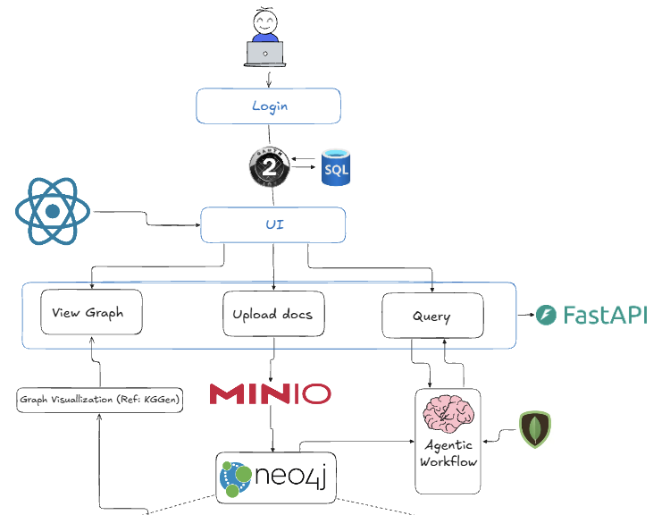
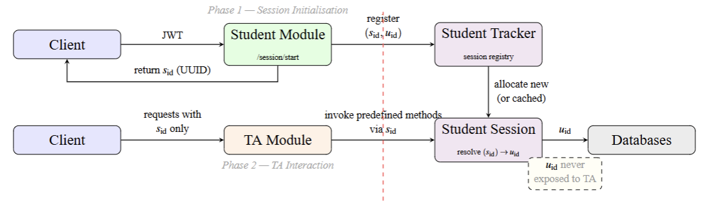
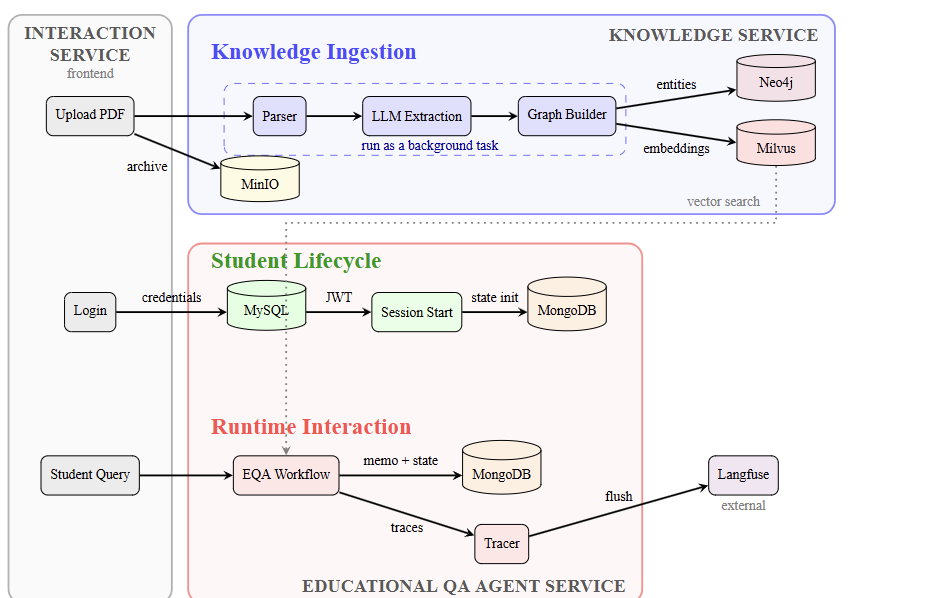
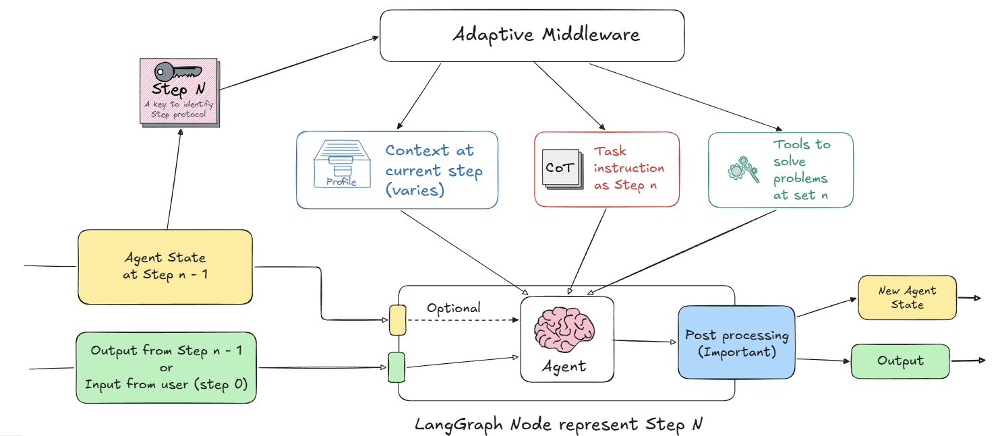
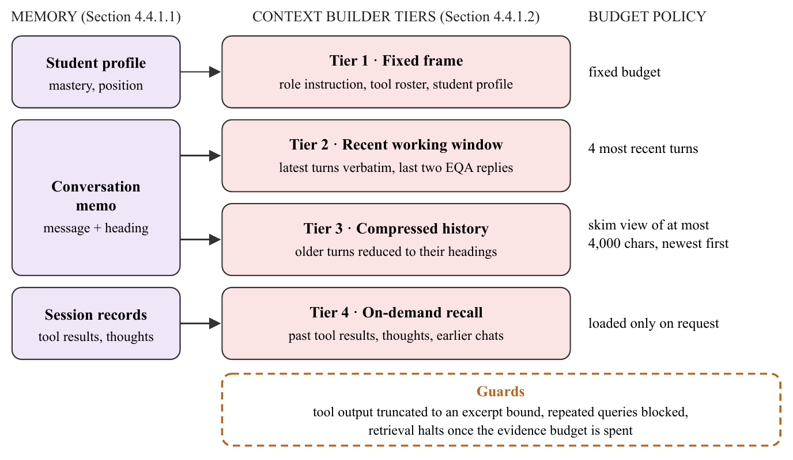
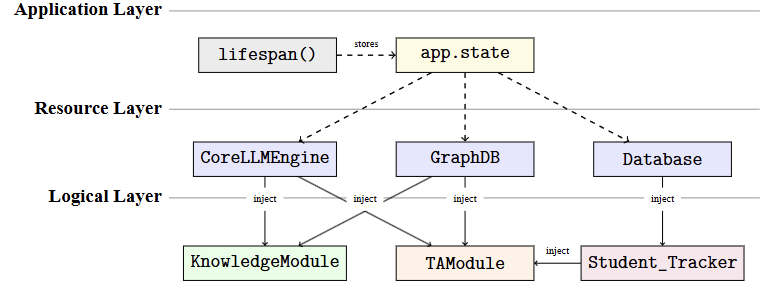

# SmartEdu
> A graph-based intelligent teaching assistant that guides and supervises mastery-oriented learning.

## Table of contents
1. [Introduction](#1-introduction)
2. [Features & engineering highlights](#2-features--engineering-highlights)
3. [How it works](#3-how-it-works)
4. [Inside SmartEdu](#4-inside-smartedu)
   - [Knowledge graph](#the-knowledge-graph) · [Teaching assistant](#the-teaching-assistant) · [Context injection](#context-injection) · [System architecture](#system-architecture)
5. [Infrastructure & how to run](#5-infrastructure--how-to-run)

## 1. Introduction
- **SmartEdu** is a proactive, mastery-oriented learning platform.
- It acts like a human TA: tracks what a student has learned, then walks them through a Knowledge Graph one concept at a time.
- The graph guarantees the order is sound (no circular prerequisites).

Further reading: [Full project report](docs/HK253-DATN-011.pdf) · Slides (coming soon) · Live app (coming soon)

> [!NOTE]
> The current build targets the Computer Science curriculum and is at its demo phase.

## 2. Features & engineering highlights

### Features
- **Automated ingestion.** Slides, textbooks and lecture videos are read and transcribed automatically.
- **Knowledge graph.** Sources become an Educational Knowledge Graph (EKG) of concepts, prerequisites and related ideas.
- **Mastery tracking.** Proficiency scored per concept; gaps decide what comes next.
- **Grounded tutor.** Multi-agent tutor answers from verified sources, plans a learning path, and cites the exact page.

### Technical highlights

**Durable, distributed ingestion**
- Upload returns a flow-run ID at once; work runs in the background on Prefect.
- Root flow dispatches OCR, LLM-extraction and speech-to-text stages to capability-routed worker pools (can sit on different machines).
- Stage results cached per source version, so unchanged files are cache hits.
- Every run writes a report; the admin UI tracks it as a job card.

**Dynamic agent & context injection**
- Task-based harnessing: a local 8B model is the RAG worker; a large model orchestrates (routes, plans, teaches, writes the reply).
- One agent is reshaped per LangGraph step by middleware, so no extra model instances.
- Agents never build their own context; the system injects it per step:
  - **Context builder:** 4 budgeted tiers (fixed frame, recent window, compressed history, on-demand recall).
  - **Middleware:** node-specific output schema, policy-defined prompt, tools and call caps.
  - **Run context:** scope and harness fixed by the system, never by the model.
  - **Tools:** session-bound, isolated per student, capped output.
- Details: [Context injection](#context-injection).

**Independent services**
- Core, student, knowledge and TA never import each other's logic.
- They share only Pydantic contracts and receive dependencies by injection.
- Any service can be deployed alone by swapping its provider for an HTTP client.

**Stack:** FastAPI, Next.js, LangGraph, LangChain, Prefect, Ollama, OpenRouter, Neo4j, Milvus, MongoDB, MinIO, MySQL, Docling, spaCy, SciBERT, faster-whisper.

## 3. How it works

A student signs in, then everything flows through the same backend.



**Sign in**
- Credentials checked against MySQL; server returns an access token, a refresh token (HTTP-only cookie) and a random session ID.
- The session ID stands in for the student downstream: the tutor and its tools never see the real identity.
- The Student Tracker resolves it back only just before a database call (the dashed red line is this identity firewall).
- Past sessions can be listed and resumed; ownership is verified on every read.



**Paths from the UI**
- **Chat.** Question goes to the agentic workflow (Neo4j for knowledge, MongoDB for student state). Returns a task ID; UI polls or streams the answer.
- **Read evidence.** Citations open the source PDF at the cited page beside the chat.
- **Search & roadmap.** Search concepts and passages; browse a course outline with prerequisites and personal mastery.
- **Upload sources.** Admin only: presigned upload to MinIO, start ingestion, follow the job card.

## 4. Inside SmartEdu



### The knowledge graph
- Property graph with a small ontology: communities, topics, concepts, and rhetorical fragments.
- Edges carry meaning: PART OF, RELATED TO, PREREQUISITE OF.
- Prerequisite edges form a DAG, so they sort topologically into a learning order.
- **Two-pass extraction** (a single LLM pass hallucinates):
  - Pass 1 pulls the hierarchy skeleton.
  - Pass 2 only draws edges between the fixed concept set.
- **Deterministic cleanup between passes:** normalize and lemmatize, check against DBpedia, merge near-duplicates, cache verified nodes.
- Concepts DBpedia cannot confirm stay as low-weight leaf nodes.
- **Textbooks and videos never create concepts.** They become passages and time-stamped segments; slide concepts are anchored into them by vector search. This enables page-level citation.

### The teaching assistant
- A router (no tools, temperature 0) classifies each turn into one of five intents:
  - **Retrieve.** Factual answers via a versioned retrieval harness (agentic tool loop by default; ledger and fan-out harnesses kept for ablation).
  - **Roadmap.** Ranks concepts by out-degree centrality, finds the shortest prerequisite path, runs a critic-actor review, then waits for student confirmation.
  - **Teach.** Retrieve evidence, deliver at the student's Bloom level, ask a question, judge the answer, then advance or hold the concept. No evidence found: general knowledge, no citations.
  - **Confirm.** Applies a pending proposal the student agreed to.
  - **Unknown.** Anything else.
- **Models by role:** RAG worker is qwen3:8b on local Ollama; the TA orchestrator is gpt-oss 120B; experimental harnesses add a long-context aggregator via OpenRouter.

### Context injection
Agents never assemble their own context. Middleware reads the step name and hands over only what that task needs.



#### Context builder
Memory (student profile, conversation memo, session records) feeds four tiers, each with its own budget.



- **Tier 1 · Fixed frame:** role instruction, tool roster, student profile (mastery, position). Fixed budget.
- **Tier 2 · Recent working window:** 4 latest turns verbatim, plus the TA's last two replies.
- **Tier 3 · Compressed history:** older turns reduced to headings; at most 4,000 chars, newest first.
- **Tier 4 · On-demand recall:** past tool results, thoughts, earlier chats; loaded only when the agent asks (max 5 entries × 600 chars).
- **Guards:**
  - Tool output truncated to an excerpt bound.
  - Repeated queries blocked.
  - Retrieval halts once the evidence budget is spent; cited evidence goes first, uncited is capped.

#### Injection channels
- **Middleware at every model call**
  - Node name selects the output schema.
  - A frozen, hashed retrieval policy sets the prompt, tool roster, per-round and per-run call caps.
  - Repeated queries rejected; search stops before the context budget runs out.
  - Call counters live in private state the model cannot see.
- **Run context**
  - Preset, policy, harness and course scope resolved once per turn by the system.
  - The model cannot choose its own scope or tools.
- **Session-bound tools**
  - Session and tracker injected through async-safe context variables: sessions never see each other.
  - Agents never touch a database directly.

### System architecture
- Each service builds expensive resources once, lazily, and shares them by reference.
- The lifespan handler creates the LLM engine and DB clients at startup and injects them into services.



- **Five stores, each for what it does best:**
  - Neo4j: knowledge graph and per-student mastery.
  - Milvus: SciBERT vector search.
  - MongoDB: session state and chat history.
  - MinIO: source files, chunks, ingestion reports.
  - MySQL: credentials.
- **One-write policy:** each collection has exactly one writer; everyone else reads.
- **Ingestion runs outside the API:**
  - Knowledge service validates, checks a worker is alive for each needed capability, and submits a flow run.
  - Prefect keeps metadata in PostgreSQL and stage results in a private SFTP store; MinIO stays the domain store.
- Every agent step is traced to disk and Langfuse.

### Where it stands today
- Done end-to-end: infrastructure, auth, slide and textbook ingestion, all five workflows.
- In progress: video ingestion, still being validated.
- Ablation instrument benchmarks RAG vs FULL retrieval across three harnesses (agentic, ledger, deterministic fan-out+RRF as frozen control).
- Known wrinkles: graphs past ~100 nodes are hard to read; DBpedia occasionally accepts an odd name.
- Next: formal benchmark numbers.

## 5. Infrastructure & how to run
### Infrastructure
- **Backend:** FastAPI (Python) services, Next.js frontend.
- **Orchestration:** Prefect control plane with OCR, LLM and ASR worker pools.
- **Models:** Ollama (local and cloud), OpenRouter.
- **Persistence:** Neo4j, Milvus, MongoDB, MinIO, MySQL.

### How to run
1. Install Docker, Python 3.12+, Node.js and [uv](https://docs.astral.sh/uv/#installation).
2. From the repo root: `uv sync`, then `cd capstone`.
3. Create `core/.env` from `core/.env.example`, then start the databases:
   ```bash
   docker compose -f core/repo/docker-compose.yaml --env-file core/.env up -d
   ```
4. Start the backend (inside `capstone/`):
   ```bash
   uv run uvicorn main:app
   ```
5. Start the frontend (port 3002; set `NEXT_PUBLIC_API_URL` to the backend origin):
   ```bash
   cd FE && npm install && npm run dev
   ```
6. For ingestion, set up Prefect and workers via [infra/prefect/README.md](infra/prefect/README.md).
   - Without Prefect, any `INGEST_ORCH` value other than `prefect` ingests PDFs inline.
   - Video needs Prefect.

More: [capstone/TA/README.md](capstone/TA/README.md) (agent module, benchmark) · [capstone/FE/README.md](capstone/FE/README.md) (frontend).
