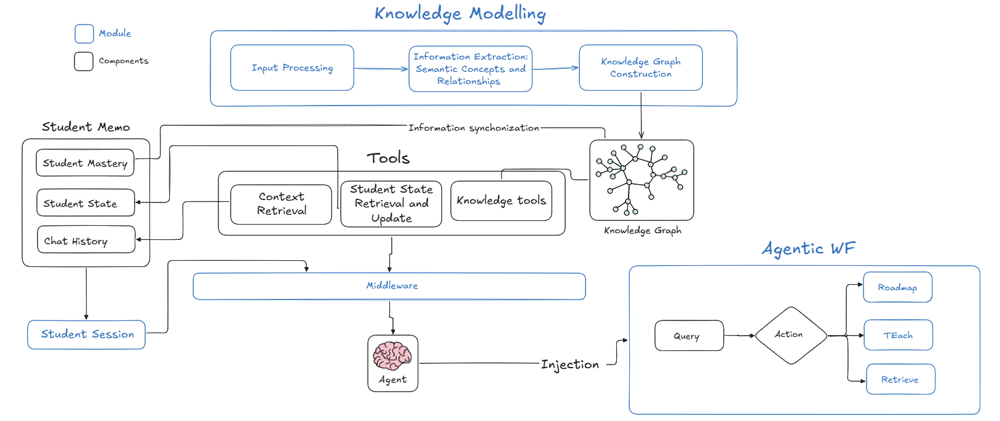

# SmartEdu
> A graph-based teaching assistant that guides students through a course one concept at a time, in an order the knowledge graph guarantees is sound.

Instead of serving static content, SmartEdu behaves like a human TA: it tracks what a student has actually learned, plans what to learn next, teaches it, checks understanding, and cites the exact page it drew from.

[Full project report](docs/HK253-DATN-011.pdf) · Slides (coming soon) · Live app (coming soon)

> [!NOTE]
> The current build targets the Computer Science curriculum and is at its demo phase.

## Features
- **Automated ingestion.** Drop in lecture slides, textbooks and videos; the system reads, transcribes and turns them into an Educational Knowledge Graph of concepts, prerequisites and related ideas.
- **Mastery tracking.** Proficiency is scored per concept (Bloom levels) and drives what comes next.
- **Grounded tutor.** Five workflows (retrieve, roadmap, teach, confirm, unknown) answer from the graph and source material, plan a personal path, and open the cited PDF page beside the chat.

## Engineering highlights

**Durable, distributed ingestion.** Uploading a course returns a flow-run ID immediately. A Prefect root flow dispatches each heavy stage (slide OCR, textbook OCR, LLM concept extraction, video speech-to-text) to capability-routed worker pools, so stages can run on different machines. Results are cached per source version, and every run writes a report the admin UI tracks as a job card.

**A small worker under a large orchestrator, with injected context.** A local 8B model is the RAG worker that loops over retrieval tools; a large model routes the turn, plans roadmaps, teaches and writes the final reply. Agents are built once and reshaped at every LangGraph step by middleware, so one agent acts as a retriever at one node and a roadmap explorer at the next. An agent never assembles its own context: history is windowed, evidence is compiled under a character budget, and a frozen retrieval policy decides the prompt, toolset and call caps. Scope and session are injected by the system, so the model cannot pick its own tools or see another student's data.

**Independent services.** Core, student, knowledge and TA are black boxes that talk only through shared Pydantic contracts and receive dependencies through injection. Ingestion orchestration is its own Prefect service. Any service can be deployed separately by swapping its provider for an HTTP client.

**Stack:** FastAPI, Next.js, LangGraph, LangChain, Prefect, Ollama, OpenRouter, Neo4j, Milvus, MongoDB, MinIO, MySQL, Docling, faster-whisper.

## Architecture



Slides create the concepts. Textbooks and videos never do: they become passages and time-stamped segments that concepts are anchored into by vector search, which is what makes page-level citation possible. Each database holds what it is best at (Neo4j graph and mastery, Milvus vectors, MongoDB sessions and chat history, MinIO source files and reports, MySQL credentials), and every collection has exactly one writer.

Students never appear to the tutor as themselves: sign-in issues a random session ID that stands in for the student downstream and is resolved back only just before a database call.

## Status
Authentication, slide and textbook ingestion, and all five workflows run end-to-end. Video ingestion is implemented and still being validated. A harness ablation instrument benchmarks RAG against FULL retrieval; formal benchmark numbers come next.

## Run
1. Install Docker, Python 3.12+, Node.js and [uv](https://docs.astral.sh/uv/#installation).
2. From the repo root: `uv sync`, then `cd capstone`.
3. Create `core/.env` from `core/.env.example`, then start the databases:
   ```bash
   docker compose -f core/repo/docker-compose.yaml --env-file core/.env up -d
   ```
4. Start the backend (inside `capstone/`): `uv run uvicorn main:app`
5. Start the frontend: `cd FE && npm install && npm run dev` (port 3002; set `NEXT_PUBLIC_API_URL` to the backend origin).
6. For ingestion, set up Prefect and its workers via [infra/prefect/README.md](infra/prefect/README.md). Without Prefect, any `INGEST_ORCH` value other than `prefect` ingests PDFs inline; video needs Prefect.

More detail: [capstone/TA/README.md](capstone/TA/README.md) (agent module and benchmark), [capstone/FE/README.md](capstone/FE/README.md) (frontend).
